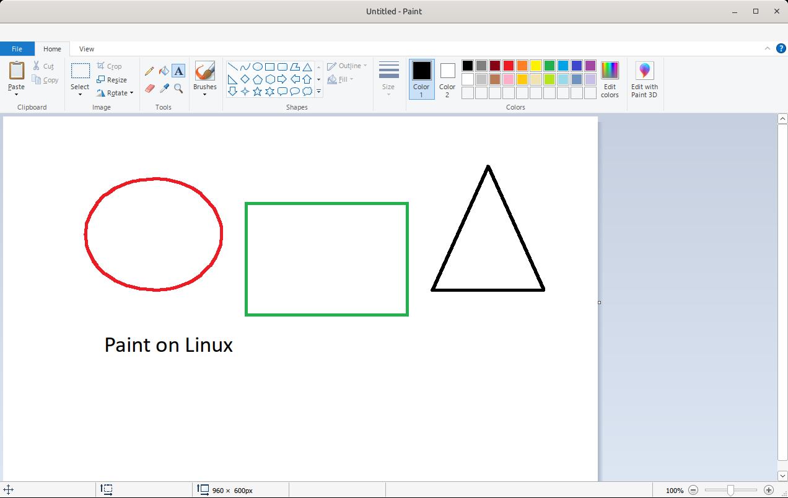

# mspaint-wine

Windows 10 Paint, the ribbon version, on Linux.

This project runs the real Windows 10 Paint under Wine. Paint does not run
correctly under plain Wine. The installer patches the Paint files and adds small
helper DLLs, so that the ribbon, saving, the text tool, the font list and the
clipboard work.

**This repository contains no Microsoft files.** The installer downloads the
Windows 10 image from Microsoft's own servers. It extracts only the files that
Paint needs, and it patches them on your computer.



## Install

```sh
git clone https://github.com/ltnkrieg/mspaint-wine.git
cd mspaint-wine
./install.sh
```

The installer does these steps:

1. It downloads a portable Wine 10.0 build (about 65 MB) from
   [Kron4ek/Wine-Builds](https://github.com/Kron4ek/Wine-Builds). Every
   distribution then uses the same Wine version.
2. It downloads the Windows 10 22H2 image from Microsoft (about 4.2 GB). This
   is the same image that the Windows 10 Media Creation Tool uses. The
   installer checks the file with the SHA-1 value from Microsoft's catalog.
3. It extracts the Paint files and about 90 common Windows fonts. Then it
   deletes the image.
4. It patches the files and installs them in a separate Wine prefix. Your
   `~/.wine` is not changed.
5. It adds Paint to the application menu, and it adds the `mspaint` command
   in `~/.local/bin`.

Start Paint from the application menu, or run `mspaint [file]`. The menu entry
also appears in "Open With" for images.

### Requirements

- A 64-bit (x86_64) Linux system with an X11 or XWayland desktop.
- `python3`, `tar`, and `curl` or `wget`.
- About 6 GB of free disk space during the install. After the install, Paint
  uses about 1.3 GB (the portable Wine is about 650 MB of this).
- Optional: `xclip`. With `xclip`, an image that you copy stays on the
  clipboard after you close Paint.

The portable Wine uses the X11, FreeType and fontconfig libraries of your
system. All desktop systems have these libraries.

### Options

| Option | Description |
| --- | --- |
| `--from PATH` | Use your own Windows files. Do not download the image. PATH can be a Windows 10 `.iso` file, an `install.wim` or `install.esd` file, a mounted Windows 10 drive, or its `Windows` folder. |
| `--lang CODE` | Language of the downloaded image, for example `de-de` or `fr-fr`. The default is `en-us`. Paint then shows its menus in that language. |
| `--system-wine` | Use the Wine of your system. Do not download Wine. Wine 9.0 and 10.0 are tested. |
| `--fonts SET` | `default` installs about 90 common Windows fonts. `all` installs all the fonts of the image. `none` installs no fonts. |
| `--pictures` | Open and Save As start in Pictures, as on Windows. The default is Downloads. |
| `--keep-download` | Keep the downloaded image in `~/.cache/mspaint-wine`. |
| `-y` | Do not ask before the download. |

To install again, for example with other options, run `install.sh` again. The
installer keeps the Wine prefix and replaces the Paint files.

## Uninstall

```sh
./uninstall.sh
```

This removes the Wine prefix, the portable Wine, the downloads, the menu entry
and the `mspaint` command. Images that you saved outside the Wine prefix are
not removed.

## What the patches do

`lib/mspaint_patch.py` makes all the changes. It uses only the Python standard
library. It finds each code patch with a byte pattern, not with a fixed
address. It is tested with Paint 10.0.19041.3758 (in the Microsoft image) and
10.0.19041.4046 (from an updated Windows 10).

1. **Resources.** Wine does not load `.mui` and `.mun` files. Their resources
   are merged into `mspaint.exe`, `uiribbon.dll` and `fms.dll` as a new
   `.rsrc` section. The manifest of `mspaint.exe` is kept: the `.mun` file has
   a manifest that only contains "placeholder", and Wine 10 then gives Paint
   the old common controls, so Paint crashes.
2. **Feature staging.** Wine does not have
   `api-ms-win-core-featurestaging-l1-1-0.dll`. The import is renamed to
   `featstage.dll`, which is a stub (`shims/featstage.c`).
3. **Ribbon.** The native `uiribbon.dll` and `uiribbonres.dll` are installed,
   with a DLL override and a CLSID registration. `uiribbon.dll` imports user32
   functions that Wine does not have (ordinals 2559 and 2704-2707). Its user32
   import is renamed to `U32SHM.dll`, a proxy that implements them and
   forwards the rest to user32 (`shims/u32shm.c`). Without ordinals 2559 and
   2707, every ribbon popup opens at the top-left corner of the screen.
4. **Ribbon on Wine 10.** `uiribbon.dll` gets user32 ordinal 2714 with
   `GetProcAddress`. Wine 10 has a stub there that raises an exception, so the
   ribbon did not appear. The lookup now gives NULL, as on Wine 9, and
   `uiribbon.dll` then skips the call.
5. **Save.** Some Paint builds start GDI+ with version 3, which Wine rejects,
   so every save failed with "Cannot save file". The version is changed to 2.
6. **Save As.** Paint calls `PSGetPropertyDescriptionListFromString` and
   `IFileSaveDialog::SetCollectedProperties` for Windows Information
   Protection. Both are stubs in Wine. The block is skipped.
7. **Default folder.** The routine that finds the default folder always uses a
   known folder. Open and Save As start in Downloads (or in Pictures with
   `--pictures`).
8. **Copy and paste.** `mfc42u.dll` delay-loads
   `api-ms-win-core-com-l2-1-1.dll`, where Wine's `StgCreateDocfileOnILockBytes`
   is a stub, so every copy failed. The import is renamed to `ole32.dll`.
9. **Text tool crash.** The font XML of Paint has a DTD default for an
   attribute. Wine's msxml gives a NULL node for it, and Paint crashed when you
   selected the text tool. The XML is rewritten with explicit values.
10. **Font list.** The ribbon font list needs `fms.dll`, which Wine does not
    have. The native `fms.dll` is installed. It imports
    `Bcp47Langs.dll!IsTransientLcid`, which Wine 9.0 does not have, so a stub
    is installed too (`shims/bcp47langs.c`).
11. **Clipboard and text** (`shims/pclip.c`, built into `featstage.dll`):
    - Copy also offers PNG (`image/png`). Browsers, Discord and most Linux
      programs read only PNG.
    - Paste accepts a clipboard that has only PNG.
    - When Paint closes, the copied image goes to `xclip`. Without this, the
      image leaves the clipboard when Wine stops.
    - Wine's rich edit control does not implement `EM_FORMATRANGE`, so typed
      text disappeared when you committed it. The shim draws the text on the
      canvas itself.

The shim DLLs are prebuilt in `shims/bin/`. To build them again, install
[zig](https://ziglang.org) (for example `python3 -m pip install ziglang`) and
run `shims/build.sh`. The build is reproducible.

## Known limits

- Print needs a printer in Wine. The installer does not set up a printer.
- "Edit with Paint 3D" does nothing.
- "Send in email" opens your system mail program.
- Wine 11.0 does not copy to the X clipboard in tests, so the installer uses
  Wine 10.0.

## Tested

The installer and Paint are tested on Ubuntu 24.04, Debian 13, Fedora 44, Arch
Linux and openSUSE Tumbleweed, with the portable Wine 10.0. Paint is also
tested with a distribution's own Wine 9.0 package (`--system-wine`).

## Credits

- [Kron4ek/Wine-Builds](https://github.com/Kron4ek/Wine-Builds) for the
  portable Wine builds.
- [7-Zip](https://7-zip.org), which the installer downloads to read the
  Windows image when `7zz` is not installed.
- [Mido](https://github.com/ElliotKillick/Mido) and
  [Fido](https://github.com/pbatard/Fido), which show how to get Windows images
  from Microsoft.

Windows and Paint are trademarks of Microsoft. This project has no connection
with Microsoft.
